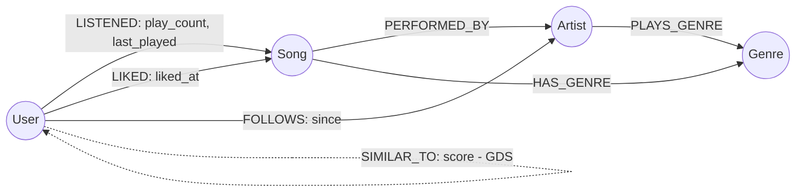
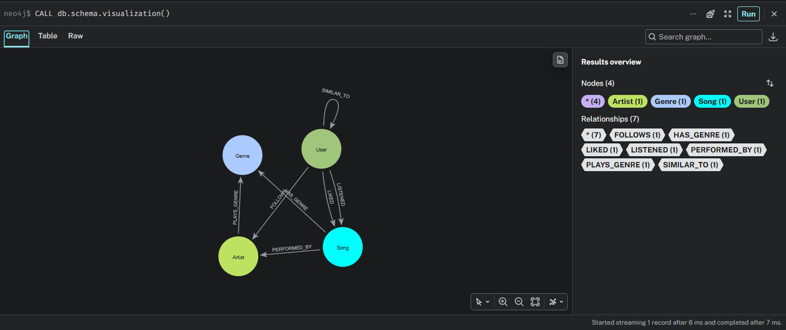
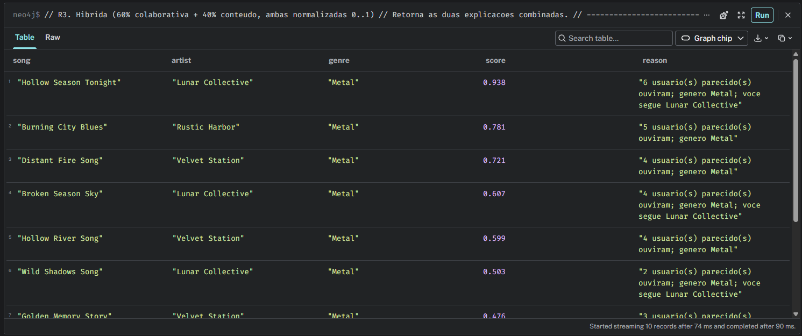
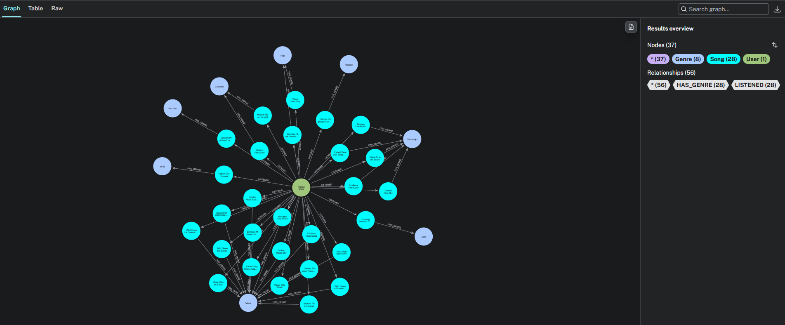
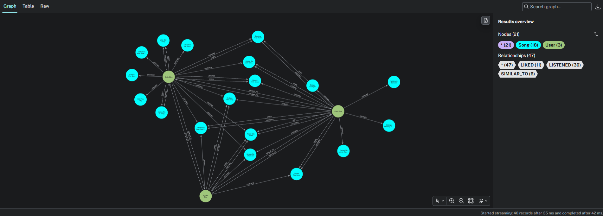
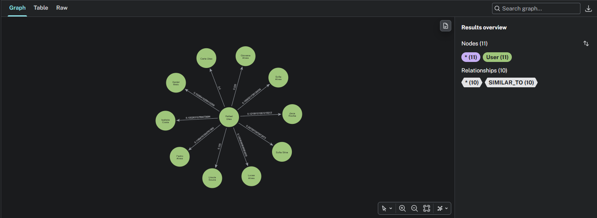

# Neo4j Music Recommendation Engine

Motor de recomendação de músicas baseado em grafos (Neo4j + Cypher + GDS), desenvolvido para o Desafio de Projeto da DIO.

> **Status:** projeto concluído e entregue. Veja o [roadmap](#roadmap).

## Por que grafos?

Recomendar música é, essencialmente, percorrer conexões: *"quem ouviu o que eu ouvi também ouviu..."*. Em um banco relacional isso exige JOINs encadeados sobre tabelas de interações que crescem rápido. No grafo, a travessia `Usuário → Música → Outro usuário → Música` é nativa, o custo depende da vizinhança visitada (não do tamanho total da base), e a consulta se lê quase como a pergunta de negócio.

## Modelo do grafo



```
(:User)-[:LISTENED {play_count, last_played}]->(:Song)
(:User)-[:LIKED    {liked_at}]->(:Song)
(:User)-[:FOLLOWS  {since}]->(:Artist)
(:Song)-[:PERFORMED_BY]->(:Artist)
(:Song)-[:HAS_GENRE]->(:Genre)
(:Artist)-[:PLAYS_GENRE]->(:Genre)      // derivada na carga
```

| Nó | Propriedades |
|---|---|
| `User` | `id`, `name`, `country`, `age` |
| `Song` | `id`, `title`, `year`, `duration_sec` |
| `Artist` | `id`, `name`, `country` |
| `Genre` | `id`, `name` |



*(imagem gerada com `CALL db.schema.visualization()`; veja [`docs/EVIDENCIAS.md`](docs/EVIDENCIAS.md))*

## Como executar

Pré-requisitos: Docker e Python 3.9+.

```bash
# 1. Credenciais
cp .env.example .env          # edite NEO4J_PASSWORD

# 2. (Opcional) regenerar o dataset sintético determinístico
python scripts/generate_dataset.py

# 3. Subir o Neo4j (com APOC e GDS)
docker compose up -d

# 4. Criar schema e carregar os dados
docker exec -i music-recommender-neo4j cypher-shell -u neo4j -p <SENHA> < cypher/00_schema.cypher
docker exec -i music-recommender-neo4j cypher-shell -u neo4j -p <SENHA> < cypher/01_load.cypher
```

Atalho (Git Bash/Linux/macOS): `./run.sh all` sobe o Neo4j, carrega, calcula a similaridade GDS e roda os testes. Outros comandos: `./run.sh recs 7` (recomendações do usuário 7), `./run.sh business`, `./run.sh down`.

Neo4j Browser: http://localhost:7474 (Bolt: `bolt://localhost:7687`).

Resultado esperado da carga: 50 `User`, 188 `Song`, 30 `Artist`, 10 `Genre`, 928 `LISTENED`, 327 `LIKED`, 128 `FOLLOWS`.

## Recomendações

Arquivo `cypher/02_recommendations.cypher` (parâmetros `:param userId => 1`). Todas retornam `song, artist, genre, score, reason`, com a explicação do motivo.

| Query | Pergunta de negócio | Técnica |
|---|---|---|
| R1 | O que usuários parecidos comigo ouviram e eu não? | Filtragem colaborativa (Jaccard sobre escutas; curtidas dão bônus) |
| R2 | Que músicas novas combinam com o que mais escuto? | Baseada em conteúdo (afinidade por gênero + bônus por artista seguido/curtido) |
| R3 | Qual a melhor recomendação combinando as duas? | Híbrida: 60% colaborativa + 40% conteúdo |
| R4 | Que artistas devo seguir? | Artistas seguidos por quem segue os mesmos que eu |

`cypher/03_gds_similarity.cypher` usa **GDS Node Similarity** para gravar relações `SIMILAR_TO` e recomendar a partir dos vizinhos pré-calculados.

```bash
docker exec -i music-recommender-neo4j cypher-shell -u neo4j -p <SENHA> < cypher/02_recommendations.cypher
docker exec -i music-recommender-neo4j cypher-shell -u neo4j -p <SENHA> < cypher/03_gds_similarity.cypher
python tests/run_tests.py     # 7 testes de integridade e qualidade das recomendações
```

## Queries de negócio

`cypher/04_business_queries.cypher` responde, entre outras: músicas e gêneros mais ouvidos, artistas com mais seguidores (e quantos fãs curtiram), usuários mais parecidos, "pontes" entre gêneros e músicas subvalorizadas (muitas curtidas, poucas escutas). As queries B5 e B6 são pensadas para a visão em grafo e para os prints.

## Desempenho

`PROFILE` das recomendações para o usuário 1 (50 usuários / 188 músicas): R1 ≈ 14 mil db hits, R2 ≈ 14 mil, R3 ≈ 69 mil, R4 ≈ 740. A busca inicial usa `NodeUniqueIndexSeek` sobre `User(id)`, graças às constraints de unicidade. A R3 é a mais cara por combinar os dois componentes; em escala maior, o caminho é pré-calcular vizinhos com GDS (`SIMILAR_TO`) e ler só as arestas.

## Estrutura

```
cypher/    schema, carga, recomendações, GDS e queries de negócio
data/      CSVs de amostra (montados em /var/lib/neo4j/import)
scripts/   gerador do dataset
docs/      imagens e evidências
tests/     validações das queries
```

## Dataset

Sintético e determinístico (`seed=42`). Cada usuário tem 1–2 gêneros preferidos (80% das escutas) e 20% de exploração, o que cria comunidades de gosto reais e permite validar que as recomendações fazem sentido.

## Evidências

**Recomendação híbrida (R3), com a explicação do motivo** para o usuário 1:



**Vizinhança do usuário (B5):** o que ele ouviu e os gêneros envolvidos:



**Por que recomendar? (B6):** caminho usuário → música em comum → usuário parecido → música nova:



**Similaridade calculada com GDS (`SIMILAR_TO`)**, com o score em cada aresta:



## Troubleshooting

| Problema | Causa | Solução |
|---|---|---|
| Container em loop de restart com `chown: ... Read-only file system` | O entrypoint do Neo4j faz `chown` no diretório de import; o mount foi feito com `:ro` | Montar `./data` sem `:ro` |
| `Property existence constraint requires Neo4j Enterprise Edition` | Constraints `IS NOT NULL` não existem na Community | Usar apenas unicidade e validar nulos na carga/testes |
| `Illegal expression(s)` ao agregar no `RETURN` | Misturar agregação com variáveis de agrupamento implícitas | Agregar em um `WITH` antes do `RETURN` |
| Gerador do dataset travava | Espaço de títulos únicos (144) menor que o número de músicas, causando loop infinito | Ampliar o vocabulário de títulos |

## Roadmap

- [x] **Etapa 1:** Docker, schema, dataset, carga idempotente
- [x] **Etapa 2:** recomendações: filtragem colaborativa, baseada em conteúdo, híbrida, similaridade com GDS e explicação do motivo
- [x] **Etapa 3:** testes (`tests/run_tests.py`), `PROFILE`/`EXPLAIN`, `run.sh`
- [x] **Etapa 4 (código/docs):** diagrama, queries de negócio, roteiro de evidências
- [x] Prints das evidências
- [x] **Entrega:** publicado no GitHub e enviado na DIO
